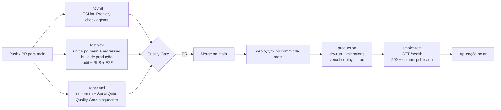

# Relatório técnico de CI/CD — P5 (Grupo G4 SpendSmart)

**Issues:** [MViniciusCoffe/SpendSmart#107](https://github.com/MViniciusCoffe/SpendSmart/issues/107)
e [tacianosilva/bsi-tasks#609](https://github.com/tacianosilva/bsi-tasks/issues/609)  
**Equipe:** José Samuel Silva Lima ([@Jose-Samuel-Lima](https://github.com/Jose-Samuel-Lima)) e
Marcus Vinícius de Souza Azevedo ([@MViniciusCoffe](https://github.com/MViniciusCoffe))  
**PRs de entrega:** [#PR_PROJETO_P5](https://github.com/MViniciusCoffe/SpendSmart/pull/#PR_PROJETO_P5)
e [#PR_DISCIPLINA_P5](https://github.com/Jose-Samuel-Lima/bsi-tasks/pull/#PR_DISCIPLINA_P5)  
**Data:** 21/11/2026

---

## 1. Visão geral e arquitetura da esteira

A esteira consolida o que a T4 já entregou
([PR #104](https://github.com/MViniciusCoffe/SpendSmart/pull/104),
[issue #604](https://github.com/tacianosilva/bsi-tasks/issues/604)) com a documentação e os ajustes
de verificação pedidos na P5. O motor continua sendo **GitHub Actions**; o CD publica na
**Vercel**, com **Supabase** como banco e Auth gerenciados.



### Estágios

| Estágio                 | Workflow                                                          | O que bloqueia                                                                                                                                                               |
| :---------------------- | :---------------------------------------------------------------- | :--------------------------------------------------------------------------------------------------------------------------------------------------------------------------- |
| Setup e lint            | [`.github/workflows/lint.yml`](../.github/workflows/lint.yml)     | Node 24 com cache npm, `npm ci`, ESLint, Prettier e `check:agents`                                                                                                           |
| Testes e build          | [`.github/workflows/test.yml`](../.github/workflows/test.yml)     | 241 unitários com cobertura, 27 de integração (pg-mem), 78 de regressão, `npm run build`, `npm audit --omit=dev`, 36 de RLS/Supabase e 19 E2E (Playwright/Chromium headless) |
| Métricas e Quality Gate | [`.github/workflows/sonar.yml`](../.github/workflows/sonar.yml)   | LCOV enviado ao LABENS com `sonar.qualitygate.wait=true`; gate reprovado falha o job                                                                                         |
| CD                      | [`.github/workflows/deploy.yml`](../.github/workflows/deploy.yml) | Só na `main`, depois de `lint`, `tests` e `sonar`; environment `production` exige aprovação, migrations com dry-run e deploy na Vercel com `APP_COMMIT_SHA`                  |
| Smoke test              | job `smoke-test` do `deploy.yml`                                  | Até 6 tentativas no `/health`; exige HTTP **200** e `commit` igual ao do deploy                                                                                              |

Os workflows de lint, teste e Sonar rodam no PR e, na `main`, são chamados por `workflow_call`
dentro do `deploy.yml` no commit que vai para produção. Isso evita executar duas vezes a mesma
verificação — uma pelo push direto e outra pelo deploy — e garante que o commit publicado é
exatamente o que passou pela CI.

---

## 2. Cultura DevOps e testes contínuos

**Eliminação de atritos.** A branch `main` é protegida por PR obrigatório; quem revisa é a CI.
Não existe "rodou na minha máquina": o mesmo `npm ci`, Node 24 e os mesmos comandos do
`package.json` rodam no PR e de novo no commit que vai para produção. A aprovação humana
permanece apenas onde o risco é irreversível: aplicar migration e publicar.

**Repetibilidade sem container.** O `npm ci` com `package-lock.json` versionado e o cache de npm
do `actions/setup-node` tornam o build reproduzível. A etapa `Verificar build de produção` do
`test.yml` roda `npm run build` na CI, com variáveis `NEXT_PUBLIC_*` de placeholder — elas são
inlined no build e só precisam existir para compilar. A Vercel reconstrói a aplicação com as
variáveis reais no deploy, que continua sendo o artefato de produção. Esses mecanismos fazem o
papel que um build de imagem faria, sem exigir Dockerfile, Compose ou registro de imagens.

**Shift-Left.** A cada PR, testes rápidos (unitários, pg-mem, regressão), lint, auditoria de
dependências, RLS contra Supabase real, E2E headless, build de produção e o Quality Gate do
SonarQube rodam antes do merge. A simulação de regressão do portão já foi registrada na T4: o
commit `fdcd531` derrubou `test`, `sonar` e `mutation`, o merge foi bloqueado e o deploy nem chegou
a rodar; o commit corretivo `ac7759f` restabeleceu os checks verdes.

**Shift-Right.** Depois do deploy, o job `smoke-test` consulta a URL pública que o usuário abre,
não uma URL interna do deploy. Ele valida o `/health` (banco **e** Auth, com `503` quando algo
falha) e confere o campo `commit`, para não dar verde sobre uma versão antiga depois de um
Instant Rollback. A tolerância é de 6 tentativas, 10 s entre elas e 10 s por requisição.

### Por que não há Dockerfile multi-stage

A issue #107 chegou a listar `Dockerfile`, `docker-compose.yml` e job de build da imagem como
itens pendentes. Seguindo a orientação do Marcus — reforçada nesta entrega — eles **não foram
implementados**: a Vercel já produz, publica e versiona o artefato da aplicação, e o Supabase já
fornece banco e Auth. Criar um container próprio adicionaria uma segunda forma de empacotar o mesmo
sistema, com mais uma coisa para manter e sem ganho de qualidade no ambiente usado pela disciplina.

O que fica no lugar é a verificação do build na CI (`npm run build` no `test.yml`) e o deploy na
Vercel com `APP_COMMIT_SHA`. O `infra/compose.yaml` pré-existente continua apenas como apoio local
para quem quiser subir um Postgres puro; ele não foi alterado por esta entrega e não faz parte da
publicação.

---

## 3. Ambiente escolhido

**Opção B — plataforma em nuvem: Vercel + Supabase.** Critérios:

- o projeto é Next.js App Router com rotas serverless e não tem servidor HTTP próprio desde o
  commit `2599ad9`; a Vercel é a plataforma natural e evita manter Nginx/VM;
- o Supabase gerencia Postgres, Auth, RLS e migrations (`supabase db push`), substituindo o
  `postgres18-server` da Opção A sem provisionar servidor;
- o deploy automático da Vercel para a `main` está desligado no `vercel.json`: o único caminho para
  produção é o `deploy.yml`, com CI completa, aprovação do environment `production`, dry-run das
  migrations e `vercel deploy --prod --env APP_COMMIT_SHA=<sha>`;
- nenhuma credencial vive no repositório. `VERCEL_TOKEN`, `VERCEL_ORG_ID`, `VERCEL_PROJECT_ID` e
  `SUPABASE_PROD_DB_URL` são secrets do environment; `SONAR_TOKEN` e `SONAR_HOST_URL` são secrets
  usados pelo `sonar.yml`.

**Ambiente local.** `supabase start` é o padrão (Postgres + Auth + RLS + migrations), seguido de
`cp .env.local.example .env.local` com os valores de `supabase status` e `npm run dev`. O
`infra/compose.yaml` continua disponível para o Postgres puro, sem RLS.

---

## 4. Instruções de configuração

### Variáveis de ambiente

| Variável                                                                     | Uso                                   | Onde fica                                 |
| :--------------------------------------------------------------------------- | :------------------------------------ | :---------------------------------------- |
| `NEXT_PUBLIC_SUPABASE_URL`                                                   | Cliente Supabase e checagens de saúde | `.env.local` / Vercel; placeholder na CI  |
| `NEXT_PUBLIC_SUPABASE_PUBLISHABLE_KEY`                                       | Cliente Supabase (chave pública)      | `.env.local` / Vercel; placeholder na CI  |
| `SUPABASE_SERVICE_ROLE_KEY`                                                  | **Só testes**, nunca na aplicação     | `.env.local`                              |
| `DATABASE_URL`                                                               | Migrations remotas                    | `.env.production.remote` / não versionado |
| `APP_COMMIT_SHA`                                                             | Identifica a versão no `/health`      | injetada pelo `deploy.yml` por deploy     |
| `VERCEL_TOKEN`, `VERCEL_ORG_ID`, `VERCEL_PROJECT_ID`, `SUPABASE_PROD_DB_URL` | CD                                    | secrets do environment `production`       |
| `SONAR_TOKEN`, `SONAR_HOST_URL`                                              | Análise no LABENS                     | secrets do repositório                    |

### Rodando localmente

```bash
supabase start
cp .env.local.example .env.local   # preencher com `supabase status`
npm run dev
curl http://localhost:3000/api/health   # liveness
curl http://localhost:3000/health       # prontidão: 200 se banco e Auth estiverem no ar
```

Para reproduzir a verificação da CI sem rodar a suíte inteira:

```bash
NEXT_PUBLIC_SUPABASE_URL=http://127.0.0.1:54321 \
NEXT_PUBLIC_SUPABASE_PUBLISHABLE_KEY=placeholder \
npm run build
```

---

## 5. Links de acesso

| Recurso                                   | Link                                                                                              |
| :---------------------------------------- | :------------------------------------------------------------------------------------------------ |
| Aplicação publicada                       | <https://spend-smart-lilac.vercel.app/>                                                           |
| Endpoint de integridade                   | <https://spend-smart-lilac.vercel.app/health>                                                     |
| Repositório do projeto                    | <https://github.com/MViniciusCoffe/SpendSmart>                                                    |
| Workflow de CI/CD                         | [`.github/workflows/deploy.yml`](../.github/workflows/deploy.yml)                                 |
| Build de produção na CI                   | [`.github/workflows/test.yml`](../.github/workflows/test.yml)                                     |
| Execução de produção usada como evidência | [Actions run #44811028671](https://github.com/MViniciusCoffe/SpendSmart/actions/runs/44811028671) |
| Qualidade — SonarQube LABENS              | <http://labens.dct.ufrn.br/sonarqube/dashboard?id=spendsmart>                                     |
| Issue no projeto                          | [SpendSmart#107](https://github.com/MViniciusCoffe/SpendSmart/issues/107)                         |
| Issue na disciplina                       | [bsi-tasks#609](https://github.com/tacianosilva/bsi-tasks/issues/609)                             |
| PR no projeto                             | [#PR_PROJETO_P5](https://github.com/MViniciusCoffe/SpendSmart/pull/#PR_PROJETO_P5)                |
| PR no fork da disciplina                  | [#PR_DISCIPLINA_P5](https://github.com/Jose-Samuel-Lima/bsi-tasks/pull/#PR_DISCIPLINA_P5)         |

---

## 6. Evidências de funcionamento

**Quality Gate.** Commit `fdcd531` (PR #104, simulação documentada na T4): `test`, `sonar` e
`mutation` vermelhos; a proteção da `main` barrou o merge e o `deploy.yml` não chegou a rodar.
Commit `ac7759f` restabeleceu os checks. O `sonar.qualitygate.wait=true` está em
[`sonar-project.properties`](../sonar-project.properties).

**Deploy + smoke test.** Run
[#44811028671](https://github.com/MViniciusCoffe/SpendSmart/actions/runs/44811028671),
`conclusion: success`, com `production` e `smoke-test` verdes. Resposta capturada do `/health`
na validação da T4:

```json
{
  "status": "ok",
  "checks": { "database": "ok", "auth": "ok" },
  "version": "0.5.0",
  "commit": "a539cb6e34db14190ead5f48e568edb6a4ded0b0"
}
```

O campo `commit` é comparado com `github.sha` pelo smoke test; sem ele, um `200` de uma versão
antiga passaria despercebido ([decisão §31](tooling-decisions.md#31-smoke-test-pós-deploy-no-health-conferindo-o-commit-publicado)).
Não há screenshot em arquivo: o log de cada tentativa do job `smoke-test` registra código HTTP,
commit e corpo da resposta, e os badges do `README.md` mostram o estado atual dos workflows.

### Requisito → implementação (P5)

| Requisito do enunciado                                           | Implementação                                                                                                                                                                  |
| :--------------------------------------------------------------- | :----------------------------------------------------------------------------------------------------------------------------------------------------------------------------- |
| Issues no projeto e na disciplina                                | [#107](https://github.com/MViniciusCoffe/SpendSmart/issues/107) e [#609](https://github.com/tacianosilva/bsi-tasks/issues/609)                                                 |
| Branch temática e commits convencionais com referência           | `infra/#107-pipeline-ci-cd` e `task/609-p5`; `docs(...): ... (#107)` / `docs(...): ... (#609)`                                                                                 |
| CI no push/PR para `main`                                        | PR dispara os workflows; na `main`, o `deploy.yml` os chama por `workflow_call` no commit publicado (evita duplicação)                                                         |
| Setup, lint, unidade, integração, E2E headless, cobertura, Sonar | `lint.yml`, `test.yml`, `sonar.yml` — ver §1                                                                                                                                   |
| Build do artefato de produção na CI                              | etapa `Verificar build de produção` no `test.yml`, com `npm run build`                                                                                                         |
| Quality Gate bloqueante                                          | `sonar.qualitygate.wait=true` + checks obrigatórios na proteção da `main`                                                                                                      |
| Dockerfile multi-stage, Compose e job de build de imagem         | **Não entregues, por orientação do Marcus**: Vercel já produz/publica o artefato e o build é verificado na CI; ver §2                                                          |
| CD só após CI verde, na `main`, com credenciais em secrets       | job `production` com `needs` completo, environment com aprovação e `vercel deploy --prod`                                                                                      |
| Migrações antes da publicação                                    | `supabase db push --dry-run` e `--yes` no job `production`                                                                                                                     |
| Endpoint de integridade                                          | `GET /health` (`src/app/health/route.js`), 200/503 com banco e Auth                                                                                                            |
| Smoke test pós-deploy com retries                                | job `smoke-test`: 6 tentativas, exige 200 e `commit` igual ao publicado                                                                                                        |
| Relatório em `docs/relatorio-ci-cd.md`                           | este arquivo                                                                                                                                                                   |
| Links atualizados no bsi-tasks                                   | `softwaretesting/20262/README.md` no fork [@Jose-Samuel-Lima](https://github.com/Jose-Samuel-Lima/bsi-tasks)                                                                   |
| PR para a `main`                                                 | [#PR_PROJETO_P5](https://github.com/MViniciusCoffe/SpendSmart/pull/#PR_PROJETO_P5) e [#PR_DISCIPLINA_P5](https://github.com/Jose-Samuel-Lima/bsi-tasks/pull/#PR_DISCIPLINA_P5) |
