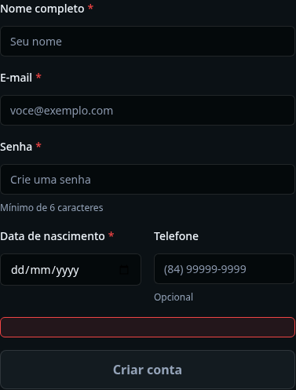
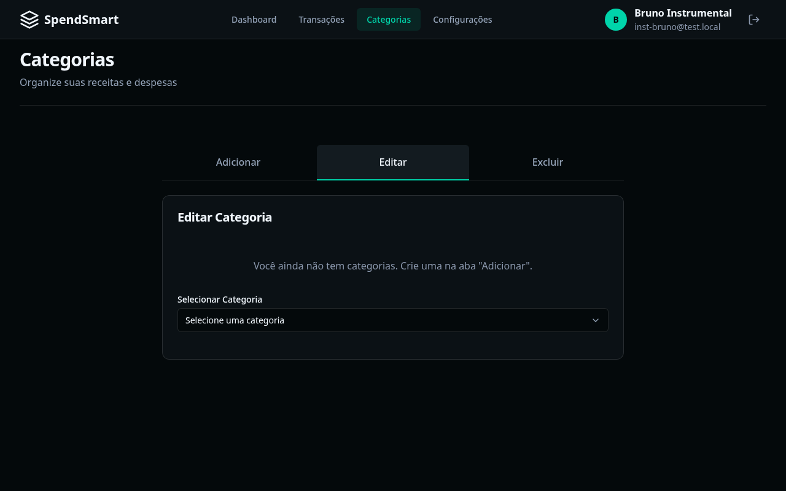
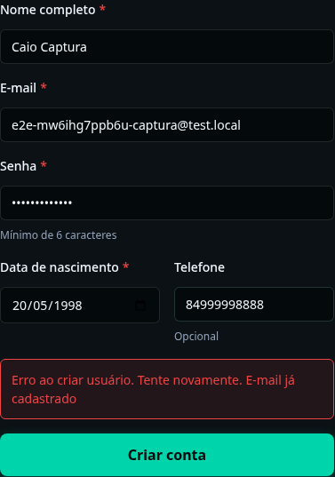
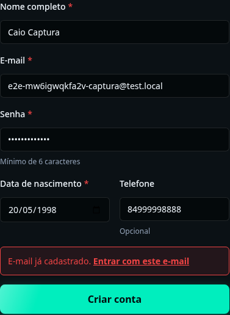

# P3 — Testes de Sistema, Testes Instrumentais com IA, Usabilidade e Acessibilidade

**Grupo:** SpendSmart (G4) — José Samuel Silva Lima (`@Jose-Samuel-Lima`) e Marcus Vinícius de Souza
Azevedo (`@MViniciusCoffe`)
**Disciplina:** Testes de Software, BSI/UFRN, 2026.2
**Issue da P3:** [#83](https://github.com/MViniciusCoffe/SpendSmart/issues/83) (repositório do projeto) · [`bsi-tasks` #577](https://github.com/tacianosilva/bsi-tasks/issues/577)
**Enunciado:** [P3.md](https://github.com/tacianosilva/bsi-tasks/blob/main/softwaretesting/20262/tarefas/P3.md)
**Plano de testes:** [test-plan.md](test-plan.md) §2.3 e §2.5

| Seção                                                                                                 | Passo do enunciado |
| :---------------------------------------------------------------------------------------------------- | :----------------- |
| [1. Pesquisa: ferramentas de E2E](#1-pesquisa-comparativa-ferramentas-livres-de-teste-de-sistema-e2e) | Passo 2            |
| [2. Pesquisa: IA em testes de sistema](#2-pesquisa-ia-em-testes-de-sistema-e-teste-instrumental)      | Passo 3            |
| [3. Prática 1: E2E com Playwright](#3-prática-1-testes-de-sistema-com-playwright)                     | Passo 4            |
| [4. Prática 2: teste instrumental por IA](#4-prática-2-teste-instrumental-com-agente-de-ia)           | Passo 5            |
| [5. Prática 3: usabilidade e acessibilidade](#5-prática-3-auditoria-de-usabilidade-e-acessibilidade)  | Passo 6            |
| [6. Conclusões e pendências](#6-conclusões-e-pendências)                                              | —                  |

---

## 1. Pesquisa comparativa: ferramentas livres de teste de sistema (E2E)

### 1.1 Matriz comparativa

| Critério                          | Selenium WebDriver / IDE                                                                                                                                                  | Cypress                                                                                                                                         | Playwright                                                                                                                               |
| :-------------------------------- | :------------------------------------------------------------------------------------------------------------------------------------------------------------------------ | :---------------------------------------------------------------------------------------------------------------------------------------------- | :--------------------------------------------------------------------------------------------------------------------------------------- |
| **Licença**                       | Apache 2.0. Tudo é livre (WebDriver, IDE, Grid).                                                                                                                          | MIT (o executor). O **Cypress Cloud** (gravação de execuções, paralelização, detecção de testes instáveis) é pago, com faixa gratuita limitada. | Apache 2.0 (Microsoft). Sem versão paga: trace viewer, relatórios e paralelização vêm no pacote livre.                                   |
| **Arquitetura de execução**       | Protocolo **W3C WebDriver** por HTTP: o teste fala com um _driver_ (chromedriver, geckodriver) que controla o navegador. WebDriver BiDi acrescenta eventos por WebSocket. | **Dentro do navegador**: o teste roda no mesmo _event loop_ da página, com um processo Node ao lado para tarefas de sistema.                    | Fora do navegador, por **WebSocket**: CDP no Chromium e protocolos próprios no Firefox e no WebKit (que o projeto mantém).               |
| **Linguagens**                    | Java, Python, C#, Ruby, JavaScript, Kotlin.                                                                                                                               | JavaScript/TypeScript.                                                                                                                          | JavaScript/TypeScript, Python, Java, .NET.                                                                                               |
| **Navegadores**                   | Todos os que têm driver (Chrome, Firefox, Edge, Safari).                                                                                                                  | Família Chrome, Firefox e Electron; WebKit experimental. Várias abas e várias origens têm restrições (`cy.origin`).                             | Chromium, Firefox e WebKit, com várias abas, contextos isolados e várias origens.                                                        |
| **Espera e estabilidade**         | Esperas explícitas escritas pelo teste (`WebDriverWait`).                                                                                                                 | Repetição automática das asserções até o tempo limite.                                                                                          | _Auto-wait_ em cada ação (visível, habilitado, estável) e asserções que repetem até o tempo limite.                                      |
| **Gravação (record & playback)**  | **Selenium IDE** (extensão do navegador) grava e reproduz, e exporta código.                                                                                              | Cypress Studio grava interações dentro de um teste.                                                                                             | `playwright codegen` grava e gera o código com seletores por papel/rótulo.                                                               |
| **Depuração visual e relatórios** | Nada embutido: capturas pela API; relatórios e vídeo por bibliotecas de terceiros.                                                                                        | _Time-travel debugging_ (instantâneo do DOM a cada comando), capturas e vídeo embutidos.                                                        | **Trace viewer** (DOM, rede e console de cada passo), modo UI, relatório HTML, capturas e vídeo embutidos.                               |
| **CI headless (GitHub Actions)**  | Funciona; o _driver_ precisa bater com a versão do navegador (o Selenium Manager resolve isso).                                                                           | Funciona com a imagem ou a Action oficial.                                                                                                      | `npx playwright install --with-deps` instala navegador e bibliotecas; `webServer` sobe a aplicação antes da suíte.                       |
| **Acessibilidade**                | `axe-core` injetado à mão ou por bibliotecas de terceiros.                                                                                                                | `cypress-axe` (comunidade).                                                                                                                     | `@axe-core/playwright` (Deque) e `toMatchAriaSnapshot` para a árvore de acessibilidade.                                                  |
| **Aderência ao SpendSmart**       | Média: multilíngue, mas sem relatório e sem espera automática, mais código para o mesmo fluxo.                                                                            | Boa para JavaScript, mas o login no Supabase Auth e o redirecionamento entre origens esbarram nas restrições de origem.                         | Alta: JavaScript como o resto do projeto, Supabase local por `webServer`, e o mesmo motor do Playwright MCP usado no teste instrumental. |

### 1.2 Decisão técnica: Playwright

1. **Mesma linguagem e mesmo ecossistema** do projeto (Next.js 16, React 19, Jest em JavaScript).
2. **Tudo livre**: relatório, trace, vídeo e paralelização sem depender de um serviço pago, ao
   contrário do Cypress Cloud.
3. **Estabilidade**: o _auto-wait_ resolveu sozinho a hidratação do React. O botão "Criar conta" nasce
   desabilitado no HTML e o `click()` espera ele habilitar, sem `sleep`.
4. **Acessibilidade no mesmo runner**: `@axe-core/playwright` transformou a auditoria do Passo 6 em
   teste automatizado que falha o CI se uma violação voltar.
5. **Comparação script × agente mais justa**: o Playwright MCP, usado por agentes de IA, opera o mesmo
   motor. No Passo 5 o agente usou o Playwright pelo protocolo CDP (seção 4.1).

Versões: `@playwright/test` 1.64.1 e `@axe-core/playwright` 4.14.0, fixadas sem `^` (regra do
projeto de não usar versão com menos de duas semanas).

---

## 2. Pesquisa: IA em testes de sistema e teste instrumental

### 2.1 Gerar script × teste instrumental

| Aspecto            | IA gera o script E2E                                         | Teste instrumental (_agentic testing_)                                                           |
| :----------------- | :----------------------------------------------------------- | :----------------------------------------------------------------------------------------------- |
| O que a IA produz  | Um arquivo de teste (`.spec.js`) que depois roda **sem** ela | Ações sobre a aplicação **em execução** e um diagnóstico                                         |
| Quando a IA atua   | Na escrita (e na manutenção) do teste                        | Durante o teste: observa, decide o próximo passo e age                                           |
| O que a IA enxerga | O código-fonte e a especificação                             | O navegador vivo: árvore de acessibilidade e DOM, console, rede, capturas de tela                |
| Resultado          | Determinístico e repetível no CI                             | Não determinístico: dois agentes, ou o mesmo agente duas vezes, podem seguir caminhos diferentes |
| Força              | Regressão barata a cada commit                               | Exploração: encontra o que ninguém escreveu como cenário                                         |

No SpendSmart as duas formas foram usadas com o Claude Code: ele ajudou a escrever o ST-01 (seção 3)
e depois atuou como QA instrumental (seção 4).

### 2.2 Agentes de IA em testes instrumentais

**Claude Code (Anthropic) + MCP.** O Claude Code roda no terminal: sobe o servidor da aplicação,
lê o código e executa comandos. Para operar um navegador, ele usa servidores **MCP (_Model Context
Protocol_)**, que expõem ferramentas ao modelo:

- **Playwright MCP** (Microsoft): navegar, clicar, preencher e ler a página como **instantâneo da
  árvore de acessibilidade**, em vez de pixels. Os elementos são identificados pelo papel e pelo nome
  acessível, como nos seletores do Playwright.
- **Chrome DevTools MCP** (Google): além de operar a página, dá acesso ao console, às requisições de
  rede e a rastros de desempenho do DevTools.
- **Puppeteer MCP**: operação do Chromium pelo Puppeteer, com capturas de tela.

O ciclo é: o agente sobe a aplicação pelo terminal, abre a página, lê o instantâneo, decide a próxima
ação, confere console e rede, e cruza o que viu com o código-fonte para diagnosticar a causa.

**Google Antigravity (Gemini).** IDE com agentes em que um **subagente de navegador** (_Browser
Subagent_), controlado por uma extensão do Chrome, opera a aplicação: clica, digita, lê o DOM, captura
telas e grava a sessão. O agente principal delega a ele a verificação de um fluxo e recebe de volta
as evidências (capturas, gravações e o relato dos passos) como artefatos revisáveis pelo usuário.

### 2.3 IA e ferramentas livres na validação de usabilidade e acessibilidade

| Ferramenta                            | O que é                                                                     | Papel                                                                                   |
| :------------------------------------ | :-------------------------------------------------------------------------- | :-------------------------------------------------------------------------------------- |
| **axe-core** / `@axe-core/playwright` | Motor de regras da Deque (MPL 2.0), sem falsos positivos por princípio      | Auditoria automática WCAG dentro dos testes (usado aqui)                                |
| **Google Lighthouse**                 | Auditoria do Chrome (acessibilidade com axe, desempenho, boas práticas)     | Pontuação 0–100 por página; útil para comparar antes × depois                           |
| **WAVE** (WebAIM)                     | Extensão do navegador que marca os problemas sobre a própria página         | Inspeção visual manual                                                                  |
| **Pa11y**                             | CLI livre (HTML_CodeSniffer ou axe)                                         | Auditoria em lote de URLs, também em CI                                                 |
| **Agente de IA**                      | Lê a árvore de acessibilidade, navega por teclado, compara texto e intenção | O que a regra automática não decide: rótulo claro, mensagem útil, idioma, fluxo de erro |

Ferramentas automáticas cobrem só parte dos critérios WCAG (a própria Deque estima cerca de 57% dos
problemas por volume). O resto, como navegação por teclado, ordem de foco, clareza das mensagens e as
**heurísticas de Nielsen**, precisa de inspeção. A IA entra aí como inspetora assistida, e a equipe
revisa o que ela aponta (seção 5.2).

---

## 3. Prática 1: testes de sistema com Playwright

### 3.1 Configuração

| Arquivo                                  | Papel                                                                                                    |
| :--------------------------------------- | :------------------------------------------------------------------------------------------------------- |
| `playwright.config.js`                   | `next build` + `next start` na porta 3100 via `webServer`, Chromium headless, trace/vídeo nas falhas     |
| `tests/e2e/support/env.js`               | Lê o `.env.local`, **recusa Supabase que não seja local**, gera e-mails por execução e apaga os usuários |
| `tests/e2e/support/pages.js`             | Ações de tela (cadastrar, entrar, sair) com seletores por papel e rótulo acessível                       |
| `tests/e2e/st-01-cadastro-login.spec.js` | Fluxo ST-01                                                                                              |
| `tests/e2e/a11y-audit.spec.js`           | Auditoria WCAG A/AA das 6 telas (seção 5.1)                                                              |
| `.github/workflows/test.yml`, job `rls`  | Mesmo Supabase local do teste de RLS, depois `npm run test:e2e`; relatório HTML como artefato            |

```bash
npx playwright install --with-deps chromium   # uma vez
supabase start
npm run test:e2e                               # build, sobe na 3100, roda, derruba
npm run test:e2e:report                        # relatório HTML
```

**Por que contra o build de produção.** Em `next dev`, a auditoria da tela `/login` não terminava:
o Fast Refresh recarregava a página em laço, com cerca de 27 recargas e 700 requisições em 8 s. No
`next start` a mesma página fez 18 requisições. Rodar contra o build testa o código que vai para a
Vercel e evita esse comportamento, que é só do modo de desenvolvimento.

### 3.2 Casos implementados e rastreabilidade com o Gherkin

| Fluxo | Teste                                                                             | Cenários Gherkin (docs/user-stories.md) | Autor do script | US desenvolvida por |
| :---- | :-------------------------------------------------------------------------------- | :-------------------------------------- | :-------------- | :------------------ |
| ST-01 | Cadastro válido cria conta e perfil, sem erro na tela (confere o perfil no banco) | CA-001.01, CA-001.04                    | Marcus          | José (US-001)       |
| ST-01 | E-mail já cadastrado mostra a mensagem, oferece "Entrar" e não cria outra conta   | CA-001.02                               | Marcus          | José                |
| ST-01 | Senha curta bloqueada no cliente, **sem nenhuma chamada a `/auth/v1/signup`**     | CA-001.03                               | Marcus          | José                |
| ST-01 | Credenciais válidas levam ao dashboard, também depois de sair                     | CA-002.01                               | Marcus          | José (US-002)       |
| ST-01 | Senha errada e e-mail inexistente dão a mesma mensagem                            | CA-002.02                               | Marcus          | José                |
| ST-02 | Registrar e consultar despesa                                                     | CA-013.01 a CA-013.04                   | **José**        | Marcus (US-013)     |

Cada teste cobre o caminho feliz ou uma regra de erro. A regra de dupla verificação do plano
(ninguém testa a própria US) definiu a autoria.

### 3.3 Execução e evidências

Execução local em 2026-11-07 (build de produção, Supabase CLI local):

```text
  ✓  1 a11y-audit.spec.js › tela /login sem violações WCAG A/AA (2.1s)
  ✓  2 a11y-audit.spec.js › tela /register sem violações WCAG A/AA (2.0s)
  ✓  3 a11y-audit.spec.js › telas privadas › tela /dashboard sem violações WCAG A/AA (3.2s)
  ✓  4 a11y-audit.spec.js › telas privadas › tela /transactions sem violações WCAG A/AA (3.4s)
  ✓  5 a11y-audit.spec.js › telas privadas › tela /categories sem violações WCAG A/AA (3.2s)
  ✓  6 a11y-audit.spec.js › telas privadas › tela /settings sem violações WCAG A/AA (3.1s)
  ✓  7 st-01-cadastro-login.spec.js › US-001 — Criar conta › CA-001.01 e CA-001.04 — cadastro válido…
  ✓  8 st-01-cadastro-login.spec.js › US-001 — Criar conta › CA-001.02 — e-mail já cadastrado…
  ✓  9 st-01-cadastro-login.spec.js › US-001 — Criar conta › CA-001.03 — senha curta é bloqueada…
  ✓ 10 st-01-cadastro-login.spec.js › US-002 — Entrar › CA-002.01 — credenciais válidas…
  ✓ 11 st-01-cadastro-login.spec.js › US-002 — Entrar › CA-002.02 — senha errada e e-mail inexistente…
  11 passed (34.4s)
```

**Controle negativo.** Para confirmar que os testes detectam defeito, a mensagem de e-mail duplicado
foi trocada no `authServices.js` por "Erro desconhecido". O CA-001.02 falhou
(`expect(locator).toContainText(expected) failed`), com captura e trace anexados. O código foi
restaurado em seguida. Depois de cada execução, nenhum usuário `e2e-*` sobra no banco.

**Independência entre testes.** A primeira versão do ST-01 rodava em modo serial: o CA-001.02 e os
testes da US-002 usavam a conta cadastrada pelo CA-001.01. Ao rodar só o CA-002.01 no modo UI do
Playwright, o teste falhou: a conta não existia, e o Auth respondeu 400. Agora cada teste cria a
própria conta pela API admin no `beforeAll` (`createAccount` em `tests/e2e/support/env.js`).
Verificado com `--fully-parallel --workers=5` (cada teste num processo separado: 5 passaram) e com o
CA-002.01 sozinho.

No CI, o relatório HTML (com trace, vídeo e captura das falhas) fica como artefato
`playwright-report` em cada execução do job `rls`.

---

## 4. Prática 2: teste instrumental com agente de IA

### 4.1 Ambiente e agente

| Item                            | Valor                                                                                                                          |
| :------------------------------ | :----------------------------------------------------------------------------------------------------------------------------- |
| Agente                          | Claude Code (modelo Claude Opus), atuando como QA instrumental                                                                 |
| Navegador                       | Chromium persistente aberto pelo Playwright, operado pelo agente via CDP, um passo por vez                                     |
| Aplicação                       | Build de produção (`next start`, porta 3100) com o Supabase CLI local e dados sintéticos                                       |
| O que o agente via a cada passo | Instantâneo da árvore de acessibilidade (`ariaSnapshot`), URL, console, respostas HTTP com erro, capturas de tela quando pedia |

**Diferença em relação a um MCP.** A sessão não usou um servidor MCP instalado. O agente controlou
o mesmo motor (Playwright) pelo terminal: cada passo era um comando que se conectava ao navegador
aberto, executava a ação decidida pelo agente e devolvia o instantâneo da árvore de acessibilidade,
o console e a rede. É o que o Playwright MCP faz por baixo, e por isso a observação e o controle são
equivalentes. A diferença é só de integração: com o MCP, as ações viram ferramentas nativas do agente
em vez de comandos.

### 4.2 Prompt

```text
Você é um QA Instrumental. A aplicação SpendSmart está em execução em http://localhost:3100 (build de
produção, Supabase CLI local, só dados sintéticos). Opere o navegador passo a passo, observando a
árvore de acessibilidade, o console e as respostas HTTP, e valide os cenários de aceitação abaixo
(docs/user-stories.md, US-001 e US-002):

- CA-001.01 — Cadastro com dados válidos cria a conta e o perfil
- CA-001.02 — E-mail já cadastrado mostra "E-mail já cadastrado" e não cria outra conta
- CA-001.03 — Senha com menos de 6 caracteres é bloqueada no cliente e o usuário é orientado
- CA-002.01 — Credenciais válidas levam ao dashboard
- CA-002.02 — Senha errada ou e-mail inexistente mostram "E-mail ou senha incorretos", sem revelar
  se o e-mail existe

Para cada cenário, registre os passos executados, a evidência e o veredito (passou/falhou). Depois,
explore fluxos vizinhos que o script não cobre (sair e entrar com outro usuário na mesma aba,
navegação só por teclado) e relate qualquer defeito, com passos para reproduzir.
```

Os cenários são os mesmos do ST-01, para que a comparação da seção 4.4 seja sobre a mesma
especificação.

### 4.3 Passos executados, evidências e veredito

| #   | Ação do agente                                                                     | O que observou                                                                                                               | Veredito                        |
| --- | :--------------------------------------------------------------------------------- | :--------------------------------------------------------------------------------------------------------------------------- | :------------------------------ |
| 1   | Abriu `/register` e leu a árvore de acessibilidade                                 | Um **`alert` vazio** dentro do formulário, antes de qualquer erro. A captura mostrou uma caixa vermelha vazia acima do botão | **Defeito encontrado** (4.3.1)  |
| 2   | CA-001.03: preencheu senha "12345" e enviou                                        | `validity.tooShort = true`, nenhuma chamada a `/auth/v1/`; a orientação é o balão nativo do navegador, no idioma dele        | Passou (com observação)         |
| 3   | CA-001.01: senha válida, telefone, enviou                                          | Dashboard, sem erro no console nem HTTP ≥ 400; no banco, 1 conta e o perfil com o mesmo id, nome e telefone                  | Passou                          |
| 4   | Saiu e tentou cadastrar o mesmo e-mail (CA-001.02)                                 | "E-mail já cadastrado. Entrar com este e-mail"; Auth respondeu 422; continua 1 conta                                         | Passou                          |
| 5   | CA-002.02: senha errada, depois e-mail inexistente                                 | As duas vezes "E-mail ou senha incorretos." (Auth 400)                                                                       | Passou                          |
| 6   | CA-002.01: credenciais válidas                                                     | `/dashboard`                                                                                                                 | Passou                          |
| 7   | Exploração: saiu da conta da Iara e entrou com o Bruno (2 categorias) na mesma aba | `/categories` mostrou "Você ainda não tem categorias", com o Header já mostrando o Bruno                                     | **Defeito reproduzido** (4.3.2) |
| 8   | Controle: Bruno numa aba nova                                                      | Freelance e Aluguel aparecem                                                                                                 | Confirma o passo 7              |
| 9   | Na aba antiga, Bruno tentou criar a categoria "Mercado"                            | HTTP 403 do PostgREST (RLS recusou) e a mensagem genérica "Não foi possível criar a categoria."                              | Confirma o impacto              |
| 10  | Navegação só por teclado em `/login`                                               | Ordem e-mail → senha → links; foco visível em todos (sombra nos campos, contorno nos links); Enter na senha envia e entra    | Passou                          |

#### 4.3.1 Alerta vazio no cadastro (regressão encontrada só pelo agente)

A primeira versão da melhoria de usabilidade da seção 5.3 passou a montar o conteúdo do erro com o
link "Entrar com este e-mail". O `AuthError` só se esconde quando não recebe filhos. Com o link,
ele sempre recebia um fragmento e passou a desenhar uma caixa de erro vazia **em toda visita** ao
cadastro.



O ST-01 passava, porque confere o **texto** das mensagens, e a auditoria axe também, porque caixa
vazia não viola WCAG. O agente viu o elemento sem texto na árvore de acessibilidade e pediu a
captura. Correção: o conteúdo só é montado quando há mensagem. O ST-01 ganhou a asserção de que o
formulário novo não tem alerta, então a regressão agora é coberta pelo script.

#### 4.3.2 Cache de sessão na troca de usuário (#76)

O defeito estava registrado por leitura de código desde 2026-11-03, mas nunca tinha sido
reproduzido. O agente o reproduziu: os services guardam a sessão por 5 minutos e continuam filtrando
pelo `user_id` do usuário anterior. Para quem entra, as listas ficam vazias, e as escritas são
recusadas pelo RLS, sem vazamento de dados, mas com um erro genérico.



A correção fica na issue #76, junto com a #67. O fluxo ST-04 do plano automatiza esse cenário e deve
falhar até a correção.

#### 4.3.3 Observações sem defeito funcional

- O menu principal tem `aria-label="Main navigation"`, em inglês, numa página `pt-BR`.
- O dashboard pula do `h1` para o `h3` ("Saldo Atual").
- A mensagem de senha curta é o balão nativo do navegador: a mensagem própria da página nunca aparece,
  porque o `minLength` do campo bloqueia o envio antes.
- O console registra `[Supabase Register Error] User already registered` num caso esperado.

### 4.4 Análise crítica: script (Passo 4) × instrumental (Passo 5)

| Critério                    | Script Playwright (ST-01)                                                                    | Agente instrumental                                                                                                     |
| :-------------------------- | :------------------------------------------------------------------------------------------- | :---------------------------------------------------------------------------------------------------------------------- |
| **Determinismo**            | Total: mesmas ações e asserções a cada execução                                              | Baixo: o agente escolheu o que explorar; outro agente ou outra sessão poderia não pensar na troca de usuário            |
| **Reprodutibilidade**       | `npm run test:e2e`, local e no CI                                                            | Depende do registro: os passos acima permitem repetir à mão, mas não há um comando que refaça a sessão                  |
| **Custo de manutenção**     | Seletores por papel e rótulo sobrevivem a mudanças de CSS; mudar texto ou fluxo exige editar | Quase nenhum: o prompt descreve a intenção, e o agente se adapta a mudanças de tela                                     |
| **Tempo de execução**       | 11 testes em 34 s (mais ~1 min de build)                                                     | ~20 min de sessão, com decisões, capturas e consultas ao banco                                                          |
| **Custo por execução**      | Minutos de CI                                                                                | Tokens do modelo a cada sessão                                                                                          |
| **Descoberta exploratória** | Só o que foi escrito: os 5 cenários passaram, sem achados novos                              | 1 regressão nova (alerta vazio), 1 defeito conhecido reproduzido pela primeira vez (#76) e 4 observações de usabilidade |
| **Papel no projeto**        | Rede de regressão a cada commit                                                              | Exploração antes de escrever o script, e diagnóstico (o agente cruza tela, console, rede, banco e código)               |

**Conclusão.** As duas formas se complementam. Na mesma especificação, o script confirmou os cenários
em 34 segundos, e repetirá isso a cada commit. O agente confirmou os mesmos cenários e encontrou o que
ninguém tinha escrito como cenário. O ciclo que funcionou foi: **o agente descobre, a equipe confirma
e o script passa a cobrir** (a asserção do alerta vazio entrou no ST-01). O agente não substitui o
script: sem a asserção nova, a próxima regressão igual só seria vista por outra sessão exploratória.

---

## 5. Prática 3: auditoria de usabilidade e acessibilidade

### 5.1 Acessibilidade (WCAG 2.2, níveis A e AA): diagnóstico inicial

Ferramenta: `@axe-core/playwright` 4.14.0 com as regras `wcag2a`, `wcag2aa`, `wcag21a`, `wcag21aa`,
`wcag22a` e `wcag22aa`, nas 6 telas do plano. As telas privadas foram auditadas com dados (uma
categoria de cada tipo e dois lançamentos). Execução em 2026-11-07, antes de qualquer correção:

| Tela            | Violações | Regra (critério)         | Elemento                           | Contraste medido               |
| :-------------- | --------: | :----------------------- | :--------------------------------- | :----------------------------- |
| `/login`        |         0 | —                        | —                                  | —                              |
| `/register`     |         0 | —                        | —                                  | —                              |
| `/dashboard`    |         1 | `color-contrast` (1.4.3) | e-mail do usuário no Header        | 3,3:1 (`#666666` em `#0b1115`) |
| `/transactions` |         1 | `color-contrast` (1.4.3) | e-mail do usuário no Header        | 3,3:1                          |
| `/categories`   |         2 | `color-contrast` (1.4.3) | Header e título `h3` do formulário | 3,3:1 e 3,99:1 (`#64748b`)     |
| `/settings`     |         2 | `color-contrast` (1.4.3) | Header e texto de ajuda da senha   | 3,3:1 e 3,99:1                 |

**Mínimo exigido:** 4,5:1 para texto normal (WCAG 1.4.3, nível AA). Todas as ocorrências vinham de
dois tokens de `src/styles/design-tokens.css`: `--color-text-muted` (24 usos) e
`--color-text-tertiary` (6 usos).

Verificação manual do que a ferramenta não mede (agente, seção 4.3, passo 10): navegação por
teclado, ordem e visibilidade do foco no login. Passou.

### 5.2 Usabilidade: heurísticas de Nielsen e Capacidade de Interação (ISO/IEC 25010:2023)

Inspeção combinada: o agente percorreu os fluxos (seção 4) e apontou os problemas, e a equipe revisou
cada um contra o código.

| Heurística de Nielsen                         | Subcaracterística ISO/IEC 25010:2023 | Achado                                                                                                     | Situação            |
| :-------------------------------------------- | :----------------------------------- | :--------------------------------------------------------------------------------------------------------- | :------------------ |
| 1. Visibilidade do estado do sistema          | Autodescrição                        | Botões mostram carregamento durante o envio; listas têm esqueleto de carregamento                          | Atende              |
| 2. Correspondência com o mundo real           | Inclusividade                        | `aria-label="Main navigation"` em inglês: leitor de tela lê em inglês numa página em português             | Problema (backlog)  |
| 3. Controle e liberdade do usuário            | Operabilidade                        | E-mail já cadastrado não oferecia caminho para entrar: o usuário precisava achar o link no rodapé          | **Corrigido** (5.3) |
| 4. Consistência e padrões                     | Operabilidade                        | A mensagem de senha curta vem do navegador, no idioma dele, e as demais vêm do app em português            | Problema (backlog)  |
| 5. Prevenção de erros                         | Proteção contra erro do usuário      | Senha mínima bloqueada no cliente; mudança de tipo de categoria com transações pede confirmação            | Atende              |
| 6. Reconhecer em vez de lembrar               | Aprendizagem                         | Rótulos visíveis em todos os campos, dicas "Mínimo de 6 caracteres" e "Opcional"                           | Atende              |
| 7. Flexibilidade e eficiência                 | Operabilidade                        | Enter envia os formulários; navegação completa por teclado no login                                        | Atende              |
| 8. Estética e design minimalista              | Engajamento                          | Textos atenuados com contraste baixo (3,3:1 e 3,99:1) prejudicavam a leitura das informações secundárias   | **Corrigido** (5.3) |
| 9. Reconhecer, diagnosticar e recuperar erros | Proteção contra erro do usuário      | "Erro ao criar usuário. **Tente novamente.** E-mail já cadastrado": mandava repetir o que não ia funcionar | **Corrigido** (5.3) |
| 9. (idem)                                     | Proteção contra erro do usuário      | Na troca de usuário na mesma aba, "Não foi possível criar a categoria." sem causa nem saída (#76)          | Problema (#76)      |
| 10. Ajuda e documentação                      | Assistência ao usuário               | Dicas de campo presentes; página "Sobre" explica o projeto                                                 | Atende              |

### 5.3 Correções aplicadas (Antes × Depois)

#### Correção 1 — Contraste dos textos atenuados (WCAG 1.4.3, nível AA)

```diff
 /* src/styles/design-tokens.css */
-  --color-text-muted: #64748b;
+  --color-text-muted: #8b98ad;
 ...
-  --color-text-tertiary: #666666;
+  --color-text-tertiary: var(--color-text-muted);
```

`#8b98ad` foi escolhido calculando o contraste contra **todos** os fundos do sistema, não só o das
telas auditadas. Ele passa até no mais claro (`--color-bg-active`), onde o anterior ficava em 2,84:1.

| Fundo                              | Antes (`#64748b`) | Antes (`#666666`) | Depois (`#8b98ad`) |
| :--------------------------------- | ----------------: | ----------------: | -----------------: |
| `--color-bg-primary` (`#04090b`)   |            4,21:1 |            3,49:1 |             6,86:1 |
| `--color-bg-secondary` (`#0b1115`) |        **3,99:1** |        **3,31:1** |             6,51:1 |
| `--color-bg-active` (`#23303a`)    |        **2,84:1** |        **2,35:1** |             4,62:1 |

| Antes                                                | Depois                                                 |
| :--------------------------------------------------- | :----------------------------------------------------- |
|   |   |
|  |  |

**Pontuação axe:** de 6 ocorrências em 4 telas para **0 violações WCAG A/AA nas 6 telas**. A
auditoria virou teste (`tests/e2e/a11y-audit.spec.js`): se uma violação voltar, o CI falha.

Custo da escolha: a diferença entre o texto atenuado e o secundário (`#94a3b8`) ficou menor (1,14:1).
A hierarquia visual segue pelo tamanho da fonte, e a legibilidade foi priorizada.

#### Correção 2 — Mensagem de e-mail já cadastrado com saída (heurísticas 3 e 9)

```diff
 // src/app/register/page.js
-        setErrorMessage(`Erro ao criar usuário. Tente novamente. ${error.message}`)
+        setErrorMessage(error.message)
+        setEmailTaken(error.message === "E-mail já cadastrado")
 ...
-        <AuthError>{errorMessage}</AuthError>
+        <AuthError>
+          {errorMessage && (
+            <>
+              {errorMessage}
+              {emailTaken && (<>{". "}<Link href="/login">Entrar com este e-mail</Link></>)}
+            </>
+          )}
+        </AuthError>
```

O service já devolvia a mensagem certa em português. A página acrescentava "Erro ao criar usuário.
Tente novamente.", que repetia o problema e mandava tentar o que não ia funcionar. O link usa a cor da
mensagem e é sublinhado, para não depender só da cor (WCAG 1.4.1).

| Antes                                                             | Depois                                                              |
| :---------------------------------------------------------------- | :------------------------------------------------------------------ |
|  |  |

O ST-01 (CA-001.02) verifica a mensagem, a ausência de "Tente novamente" e que o link leva ao login.
A primeira versão desta correção introduziu o alerta vazio da seção 4.3.1, encontrado e corrigido na
mesma sessão.

**Pull Request com as melhorias:** #`<pr>`

---

## 6. Conclusões e pendências

- **Playwright** foi adotado e está no CI: ST-01 (5 cenários de US-001/US-002) e a auditoria WCAG das
  6 telas, contra o build de produção e o Supabase local.
- **O teste instrumental encontrou o que o script não encontra**: uma regressão introduzida na própria
  P3 e a primeira reprodução real do defeito #76.
- **Acessibilidade:** de 6 violações AA para 0, com a auditoria automatizada como guarda.
- **Usabilidade:** 2 problemas corrigidos (heurísticas 3, 8 e 9); os restantes viram backlog.

| Pendência                                                                         | Responsável |
| :-------------------------------------------------------------------------------- | :---------- |
| ST-02 — Registrar e consultar despesa (CA-013.01 a CA-013.04), na mesma estrutura | José        |
| Sessão instrumental com um segundo agente (ex.: Antigravity), opcional            | José        |
| Correção do cache de sessão com teste ST-04                                       | #76 com #67 |
| `aria-label` em inglês, salto de nível de título, mensagem nativa de validação    | #82         |
